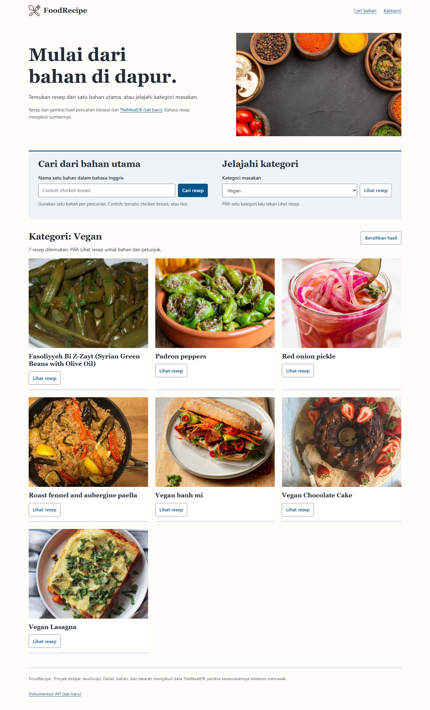

# FoodRecipe

Pencari resep dengan HTML, CSS, dan JavaScript. Masukkan satu bahan utama atau pilih kategori; aplikasi mengambil daftar resep, bahan, takaran, dan petunjuk memasak dari TheMealDB.



Screenshot diambil dari aplikasi yang berjalan di Chrome menggunakan respons TheMealDB langsung, termasuk tujuh hasil kategori Vegan pada saat pengambilan. Data dan jumlah resep dapat berubah. [Tampilan ponsel](docs/images/recipes-mobile.png) · [Detail resep](docs/images/recipe-detail.png).

## Jalankan lokal

Gunakan Python 3, browser modern, dan koneksi internet:

```powershell
git clone https://github.com/zalamanga/recipe-finder.git
Set-Location -LiteralPath '.\recipe-finder'
python -m http.server 8080 --bind 127.0.0.1
```

Buka [http://127.0.0.1:8080](http://127.0.0.1:8080). Hentikan server dengan `Ctrl+C`. Aplikasi tidak memerlukan database, akun, atau proses build. Node.js hanya dipakai untuk pengujian.

## Alur penggunaan

1. Isi satu bahan dalam bahasa Inggris, misalnya `rice` atau `chicken breast`, lalu tekan **Cari resep** atau Enter.
2. Untuk menjelajah, pilih kategori dari API dan tekan **Lihat resep**. Kategori yang dipilih digunakan dalam permintaan, termasuk saat membuka tautan kategori secara langsung.
3. Tekan **Lihat resep** pada hasil untuk membuka bahan, takaran, dan petunjuk. Tautan video atau sumber tampil jika alamatnya tersedia dan valid.
4. Tutup detail dengan tombol **Tutup resep** atau Escape. Fokus kembali ke tombol resep yang dibuka.
5. Gunakan **Bersihkan hasil** untuk memulai lagi. Saat API gagal, pesan menjelaskan keadaan dan tombol coba lagi mengulang permintaan terkait.

Contoh tautan yang dapat dibagikan:

- `http://127.0.0.1:8080/?category=Seafood`
- `http://127.0.0.1:8080/?ingredient=chicken%20breast`

Tautan lama `category.html?category=Seafood` diarahkan ke halaman utama dengan kategori yang sama. Tombol Back/Forward browser memuat ulang filter dari URL.

## API dan batas aplikasi

| Permintaan | Kegunaan |
| --- | --- |
| `categories.php` | Mengisi pilihan kategori |
| `filter.php?i=...` | Mencari satu bahan utama |
| `filter.php?c=...` | Mengambil resep dalam kategori pilihan |
| `lookup.php?i=...` | Membuka detail resep berdasarkan ID |

Endpoint memakai `https://www.themealdb.com/api/json/v1/1/`. [Dokumentasi resmi TheMealDB](https://www.themealdb.com/api.php) menyediakan key `1` untuk pengembangan dan pendidikan. Proyek ini merupakan latihan; penggunaan komersial atau distribusi app store perlu mengikuti ketentuan penyedia API.

Pencarian hanya memakai satu bahan per permintaan. Bahasa dan kelengkapan resep mengikuti sumber; aplikasi tidak menerjemahkan, menghitung gizi, atau memeriksa alergen. Tidak ada pemesanan makanan atau pengiriman formulir ke server milik repository ini.

Permintaan berhenti setelah sepuluh detik. Pencarian baru membatalkan hasil lama agar respons yang terlambat tidak mengganti pilihan terbaru. Gagal jaringan, HTTP gagal, JSON tidak sesuai, hasil kosong, detail hilang, dan gambar gagal dimuat memiliki penanganan masing-masing. Gambar hasil dibatasi ke host gambar TheMealDB; tautan detail hanya menerima HTTP/HTTPS tanpa kredensial.

## Alur kode

[Diagram alur kode](docs/CODE_FLOW.md) menghubungkan formulir, URL, pembatalan permintaan, parsing respons, dan dialog detail.

| Berkas | Tanggung jawab |
| --- | --- |
| `index.html` | Pencarian bahan, kategori, hasil, dan dialog resep |
| `src/api.js` | Validasi, URL query, timeout, pembatalan, dan normalisasi respons |
| `src/app.js` | Peristiwa DOM, URL/riwayat browser, keadaan UI, dan fokus dialog |
| `src/category-redirect.js` | Kompatibilitas tautan kategori lama |
| `style.css` | Tata letak responsif dan kontrol fokus |
| `tests/` | Tes API terisolasi dan alur browser |

## Pengujian

Dengan Node.js 22 atau lebih baru, tes logika tidak memerlukan dependency:

```powershell
npm test
```

Untuk tes browser:

```powershell
npm ci
npx playwright install chromium
npm run test:browser
```

Tes browser menggunakan respons uji yang terisolasi untuk menguji kesalahan secara konsisten. Runner membuka server loopback dan menutup server/browser saat selesai. Pengambilan screenshot API langsung dapat diulang dengan:

```powershell
$env:LIVE_API = '1'
$env:CAPTURE_README = '1'
npm run test:browser
```

Validasi terakhir: 14 tes logika dan 9 skenario browser lulus. Cakupan meliputi query yang dienkode, kategori terpilih, detail, error/retry, hasil kosong, pembatalan hasil lama, keyboard, lima lebar layar, dan teks 200%. Pemeriksaan API langsung berhasil untuk kategori, daftar Vegan, serta detail resep dengan HTTP 200.

Lihat [NOTICE.md](NOTICE.md) untuk asal source, gambar, dan batas pengambilan data.
