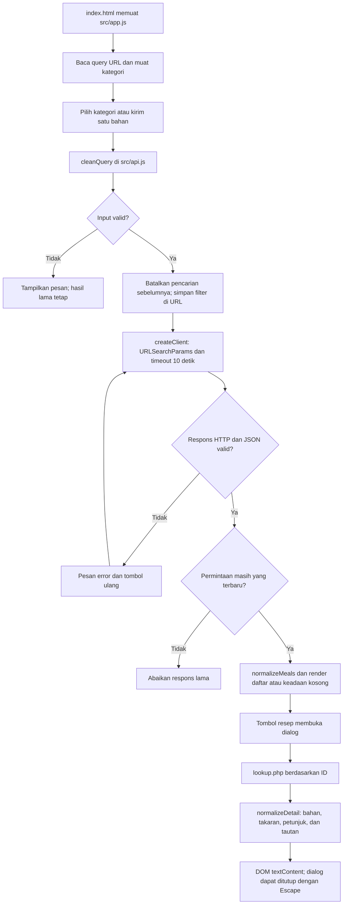

# Alur kode FoodRecipe

`src/api.js` membuat URL query memakai `URLSearchParams`. Spasi bahan diubah menjadi underscore sesuai endpoint filter; karakter `&` atau `=` tetap menjadi bagian satu parameter, bukan parameter tambahan. Kategori berasal dari pilihan pengguna atau URL, tanpa kategori tetap pada kode.

`createClient()` memberi setiap permintaan `AbortController`, batas sepuluh detik, dan penanganan HTTP/JSON/jaringan. Normalisasi memeriksa struktur array dan ID resep sebelum data dipakai UI. Hasil kosong (`meals: null`) berbeda dari kegagalan API. Detail dengan ID yang berbeda dari permintaan ditolak.

`src/app.js` memiliki pengendali terpisah untuk hasil dan detail. Saat pencarian berubah, permintaan sebelumnya dibatalkan. Setelah respons tiba, aplikasi juga memeriksa identitas pengendali; hasil lama tidak diterapkan. Menutup dialog membatalkan detail yang masih dimuat.

Filter aktif disimpan pada URL melalui `history.pushState()`. Peristiwa `popstate` membaca query kembali tanpa menambah entri riwayat baru. `src/category-redirect.js` mempertahankan kategori pada tautan lama menuju `category.html`.

UI dibangun dengan elemen DOM dan `textContent`; teks dari API tidak menjadi markup. URL gambar hanya menerima host gambar TheMealDB melalui HTTPS. Tautan sumber dan video memakai HTTP/HTTPS, menolak kredensial, serta dibuka dengan `noopener noreferrer`.

Formulir, daftar, dan dialog memiliki keadaan muat, kosong, gagal, dan coba lagi sesuai permintaannya. Dialog native menyediakan batas fokus; tombol tutup/Escape kembali ke pemicu asal.

`tests/api.test.js` menguji kontrak data, request encoding, penolakan URL, timeout, dan pembatalan tanpa API langsung. `tests/browser.mjs` menguji peristiwa UI dengan respons terisolasi. Mode `LIVE_API=1` menggunakan konteks browser lain tanpa mock untuk memeriksa endpoint publik dan mengambil screenshot.

Buka source: [klien API](../src/api.js), [penghubung DOM](../src/app.js), [pengalihan kategori lama](../src/category-redirect.js), [halaman](../index.html), [tes logika](../tests/api.test.js), dan [tes browser](../tests/browser.mjs).
